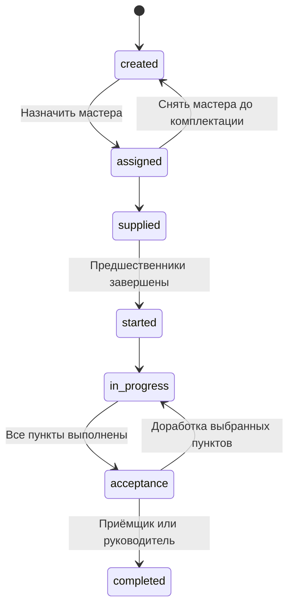

# API первой версии Stageby

Контракт описан в [OpenAPI](../contracts/references/stageby/stageby.yaml).
Он задаёт поведение для дальнейшей реализации сервера. Сейчас новые маршруты,
авторизация и бизнес-правила в Fastify ещё не реализованы.

## Согласованный объём

- Пользователи — сотрудники и исполнители. Учётные записи с логином/паролем
  создаёт руководитель, самостоятельной регистрации нет.
- Проект — объект строительства с восемью фиксированными этапами.
- У этапа один ответственный мастер и один чек-лист с несколькими пунктами.
- Фото отсутствуют: пункты отмечаются без загрузок и вложений.
- Финансовый модуль, бригады, частичные платежи, материалы, инструмент и клиентские кабинеты отложены.

## Принятые технические решения

Эти правила конкретизируют описание продукта и могут быть изменены вместе с контрактом:

| Область | Решение |
| --- | --- |
| Вход | `POST /auth/login`, непрозрачный токен в защищённой HttpOnly cookie, срок не более 12 часов; после истечения новый вход |
| Первый руководитель | Создаётся при развёртывании вне публичного HTTP API; административная команда — задача реализации |
| Роли | Одна роль на пользователя: `manager`, `estimator`, `foreman`, `inspector` |
| Приёмщик | Назначается отдельно от ответственного мастера; `inspectorId` на этапе |
| Идентификаторы | Положительные целые числа `int32` (1–2147483647), назначаемые БД через автоинкремент, независимо от номеров в исходной ведомости. Демонстрационные `todos` сохраняют UUID |
| Даты | Календарные даты без времени; первая версия использует `Asia/Yekaterinburg`; timestamps в UTC |
| Зависимости | `predecessorStageIds`, только внутри проекта и без циклов; пустой список разрешает параллельную работу |
| Порядок отображения | Неизменный `position` по типу этапа; не задаёт последовательность выполнения |
| Чек-лист | Пустой при создании, затем 3–4 пункта равного веса, как в продуктовом описании |
| Конкурентные изменения | `expectedVersion` для этапа и чек-листа; устаревшая версия — `409` |
| Удаление | Пользователь деактивируется, проект архивируется; фиксированные этапы и история не удаляются |
| Приёмка | Электронное решение с автором, датой и замечанием; генерация PDF-акта не входит в контракт |

Изменения чек-листа увеличивают обе версии:
чек-листа и этапа, поскольку влияют на прогресс и возможность приёмки.
Обновление назначений, статуса, решения приёмки или полей этапа увеличивает
версию этапа. Начальные версии — 1.

Профили и карточки проектов используют обычный PATCH без проверки версии:
при одновременном изменении одного поля сохраняется последнее принятое значение.

## Методы

| Область | Методы |
| --- | --- |
| Сессия | `POST /auth/login`, `POST /auth/logout`, `GET /auth/me` |
| Пользователи | `GET/POST /users`, `GET/PATCH /users/{userId}`, `PUT /users/{userId}/password` |
| Проекты | `GET/POST /projects`, `GET/PATCH /projects/{projectId}` |
| Этапы | `GET /stages`, `GET /projects/{projectId}/stages`, `GET/PATCH /stages/{stageId}` |
| Рабочий статус | `PUT /stages/{stageId}/status` |
| Приёмка | `POST /stages/{stageId}/acceptance`, `POST /stages/{stageId}/rework` |
| Чек-лист | `GET/PUT /stages/{stageId}/checklist`, `PATCH /stages/{stageId}/checklist/items/{itemId}` |

Списки пользователей, проектов и этапов принимают `limit` (по умолчанию 20,
максимум 100) и `offset` (по умолчанию 0). Ответ содержит `items`, `total`,
`limit`, `offset`. Фильтры и стабильный порядок перечислены в каждом методе.
Этапы одного проекта выдаются без пагинации: их не больше восьми.

## Основной сценарий

1. Руководитель входит, создаёт пользователей с ролями мастера и приёмщика.
2. Создаёт проект. Сервер атомарно создаёт восемь этапов и пустые чек-листы.
3. Через список этапов получает ID и версии. Назначает мастера и приёмщика,
   указывает плановые даты, подтипы работ и зависимости. Назначение мастера
   автоматически переводит этап из `created` в `assigned`.
4. Руководитель или инженер настраивает 3–4 пункта чек-листа до начала этапа.
5. Мастер отмечает `supplied`, затем `started`, затем `in_progress`.
   При старте сервер проверяет предшественников и заполненный чек-лист.
6. Мастер выполняет пункты, каждый раз передавая актуальную версию чек-листа.
   Сервер фиксирует автора и время, пересчитывает прогресс.
7. После выполнения всех пунктов мастер переводит этап в `acceptance`.
8. Назначенный приёмщик принимает этап или возвращает выбранные пункты
   на доработку с замечанием и датой. Руководитель также может принять решение.

Пример создания проекта:

```json
{
  "title": "Дом на участке 12",
  "ownerName": "Иван Иванов",
  "address": "Тюмень, участок 12",
  "houseDesign": "Семья 67",
  "dueDate": "2026-12-01"
}
```

Пример настройки чек-листа (версия получена из GET):

```json
{
  "expectedVersion": 1,
  "items": [
    { "title": "Проверить соответствие проекту" },
    { "title": "Проверить качество выполнения" },
    { "title": "Устранить замечания перед приёмкой" }
  ]
}
```

Это иллюстративные пункты, не утверждённый строительный регламент или шаблон.

## Статусы и доработка



Пропуск рабочего статуса запрещён. Готовность материалов пока отмечается вручную.
`actualStartDate` устанавливается при первом старте, `actualEndDate` — при приёмке.
Обе даты устанавливает сервер. Завершённый этап не открывается повторно в текущем API.

При доработке сбрасываются только пункты из `itemIds`, указанных приёмщиком.
Дата исправления обязательна, интерфейс может предложить сегодня + 2 календарных дня.
`latestAcceptance` хранит последнее решение. Полный журнал проверок и файлы актов
не входят в эту версию; для них потребуется расширение контракта.

«Выплачен» из полного продуктового описания отложен вместе с финансовым модулем и учётом платежей.

## Доступ и ошибки

Мастер видит только свои этапы, приёмщик — только назначенные ему проверки.
Они получают адрес и координаты для выезда через карточку этапа, без полной
карточки клиента. Инженер читает проекты и этапы, настраивает
чек-листы, плановые сроки и подтипы работ. Назначения и зависимости меняет руководитель.

Фильтры не расширяют права. Количество `total` считается только по доступным
записям. Обращение к чужому ID возвращает `404`, запрещённая роли операция — `403`.
Запрещённые поля в PATCH отклоняются целиком, а не молча игнорируются.

Ошибки содержат `error`, `code`, `message`, при необходимости `details`.
`400` — формат или валидация; `401` — сессия; `403` — роль;
`404` — отсутствие/недоступность; `409` — версия, логин или бизнес-состояние.
Ограничение попыток входа возвращает `429` и `Retry-After`.

При `409 version_conflict` клиент перечитывает запись и предлагает повторить
изменение с новой версией; не отправляет старый запрос автоматически бесконечно.
Зависимости и переходы проверяются внутри транзакции, включая одновременный
старт, редактирование чек-листа и архивацию проекта.

Смена пароля, деактивация и смена роли отзывают сессии. Нельзя деактивировать
последнего руководителя или оставить незавершённый этап без действующего
мастера/приёмщика: сначала нужно переназначение.

## Проверки при реализации

Генераторы создают типы и базовые Zod-схемы. Межполевые проверки дат, прав,
переходов, принадлежности пунктов, циклов зависимостей и версий реализуются
на сервере. Ограничения `minProperties` также нужно проверить в маршрутах:
генератор может не переносить их в Zod.

Сгенерированный `z.object` по умолчанию удаляет неизвестные поля. Для обещанного
контрактом отклонения неизвестных полей нужна строгая валидация, включая вложенные
объекты. `uniqueItems` требует проверки уникальности. Query-параметры приходят
строками: числовые параметры нужно преобразовывать, а `true`/`false` разбирать
явно, не превращая строку `"false"` в истину обычным приведением к Boolean.

Для тела запроса используйте схемы операций (`zCreateUserBody`, `zLoginBody`),
а не общий компонент: генератор разделяет `writeOnly`-поля на варианты чтения
и записи. В типах запросов пароль присутствует, в ответах пользователя его нет.

Проверять HTTP и БД следует интеграционными тестами: чужие объекты, отзыв сессий, конфликт версий, одновременные изменения графа,
приёмка с незавершёнными пунктами и доработка только выбранных пунктов.
Проверка OpenAPI не доказывает выполнение этих правил сервером.

Прогноз затрат по неделям и полноценные шаблоны домов не реализованы контрактом:
пока не определены метод распределения затрат и состав типовых контрольных точек.
Финансовый модуль, включая план-факт и итоги проекта, отложен.
