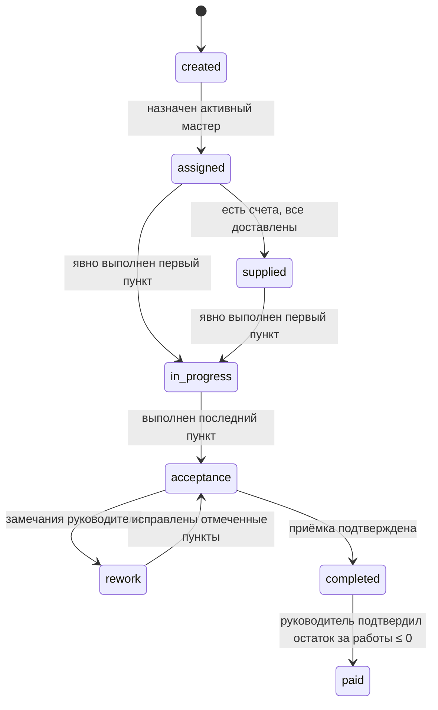

# API первой версии Stageby

Документ описывает целевое поведение API. Предметные правила определены в
[модели домена](domain-model.md) по [ТЗ edited.ver2](../plans/ТЗ%20на%20разработку%20страницы%20и%20сценарии%20edited.ver2.md), а исходники OpenAPI находятся в
[`contracts/references`](../contracts/references/). Контракт и реализация приводятся к этой модели
в следующих фазах; сгенерированный `contracts/openapi.yaml` вручную не редактируется.

По решению пользователя от 04.10.2026 приложение ещё не запущено в production. Перенос
старых данных и период совместимости со старым API заказов не требуются; при смене модели
допустим сброс локальных данных. Проверки новой модели выполняются на чистой БД.

## Согласованный объём

- В системе работают руководитель (`manager`) и мастер участка (`foreman`).
- Объект создаётся атомарно с обязательными реквизитами, выбранными этапами и индивидуальными
  копиями шаблонов чек-листа.
- Выполнение пункта требует загруженную фотографию и отдельное явное действие «Готово».
- API учитывает планы и факты работ и материалов, частичные наличные выплаты, счета этапа,
  независимые оплату и доставку и отдельно устраняемые нехватки.
- Панель руководителя получает готовые серверные агрегаты и таблицу с индикаторами без задач.
- Файлы хранятся в закрытом S3-совместимом хранилище и доступны только после авторизации.
- Клиентские кабинеты, поставщики, инструмент, ЭДО и журнал действий не входят в первую версию.

## Общие правила контракта

| Область | Решение |
| --- | --- |
| Вход | Уникальный логин и пароль; необязательный телефон; непрозрачная сессия в защищённой HttpOnly cookie; email не используется |
| Идентификаторы | Положительные `integer/int32`, назначаемые БД |
| Даты | Календарные даты без времени, ввод этапов вручную внутри срока проекта; timestamps в UTC, календарь панели руководителя UTC+5 |
| Деньги | Копейки, `integer/int64`, суффикс `AmountMinor`; записываемые суммы кратны 100 |
| Неизвестный план | `null`; значение не подменяется нулём |
| Конкурентность | `expectedVersion`; устаревшая версия возвращает `409 version_conflict` |
| Идемпотентность | Завершение загрузки и создание объекта защищаются серверным ключом; повтор после потери ответа возвращает прежний результат, другой запрос с тем же ключом — конфликт |
| Удаление | Пользователь деактивируется, проект архивируется, финансовая история физически не удаляется |
| Доступ мастера | Только назначенный этап и его вложенные ресурсы; чужой ID возвращает `404` |

API не принимает редактируемые значения для статуса проекта, прогресса, фактических сумм и
остатков. Эти поля read-only и вычисляются сервером.

## Ресурсы

Целевой контракт группирует операции следующим образом:

- аутентификация, пользователи и запросы сброса пароля;
- проекты и составное создание выбранных этапов;
- этапы, статусы, индивидуальные чек-листы, приёмка и чтение активных типов с шаблонами и `photoHint`;
- upload-сессии, файлы, документы проекта и фотографии пунктов;
- платежи за работы;
- счета напрямую в этапе: `GET/POST /stages/{stageId}/material-invoices`, оплата, доставка и нехватки;
- независимые представления панели руководителя: `summary`, `projects`.

Списки используют `limit`, `offset`, документированную стабильную сортировку и `total`, посчитанный
только по доступным записям. Read-модели экрана не обязаны совпадать с полной карточкой ресурса.

## Основной сценарий

1. Руководитель входит по логину и создаёт учётные записи мастеров. Публичной регистрации нет.
2. При необходимости руководитель предварительно загружает PDF проекта через двухфазную
   upload-сессию и получает идентификаторы успешно загруженных файлов.
3. Руководитель одной атомарной операцией создаёт объект: передаёт клиента, адрес, координаты,
   сроки проекта, минимум один выбранный этап и PDF проекта. Для каждого этапа задаёт даты,
   необязательного мастера, nullable-планы работ и материалов и пункты чек-листа. Счета добавляются
   отдельной операцией уже существующего этапа; ошибка счёта не отменяет созданный объект.
4. Если состав пунктов не передан как изменённый, сервер копирует активный шаблон типа этапа.
   Добавление, переименование и удаление пунктов изменяет только новый объект. Ошибка любого этапа
   откатывает всю операцию.
5. Назначенный мастер видит этап в «Моих этапах», включая клиента, адрес, даты и суммы только этого
   этапа. Общая карточка объекта, другие этапы и их деньги ему недоступны.
6. Руководитель добавляет напрямую в этап до 10 счетов с положительными суммами. Только руководитель
   отмечает оплату. Руководитель или назначенный мастер отмечает доставку каждого счёта и может
   сообщить о нехватке.
7. Этап становится `supplied`, только когда существует хотя бы один счёт и все счета этапа
   доставлены. Начать работу можно из `assigned`; невыполненный непосредственно предыдущий
   включённый этап вызывает предупреждение, но не блокирует старт.
8. Мастер загружает минимум одну фотографию пункта. Завершение upload-сессии сохраняет фото, но не
   меняет пункт. После успешной загрузки мастер отдельно нажимает «Готово»; сервер фиксирует автора
   и время выполнения.
9. Явное выполнение первого пункта впервые переводит этап из `assigned` или `supplied` в
   `in_progress` и устанавливает `actualStartDate`. Выполнение последнего пункта непустого чек-листа
   переводит этап в `acceptance`.
10. Руководитель принимает этап либо возвращает его в `rework`, указав комментарий, новый срок и
    хотя бы один пункт. Мастер повторно работает только с отмеченными пунктами; после их выполнения
    этап снова переходит в `acceptance`. Файл акта не требуется.
11. После приёмки руководитель переводит этап в `completed`. Платежи за работы можно добавлять
    частями; факт равен их сумме. Переход `completed → paid` руководитель подтверждает при остатке ≤ 0.
    Каждая выплата хранит получателя, который не меняется при переназначении мастера.
12. Объект получает `completed`, когда все включённые этапы достигли `paid`; отдельного статуса
    «Передан клиенту» нет. Остальные статусы вычисляются по правилам предметной модели.

Пример целевого составного запроса создания:

```json
{
  "ownerName": "Иван Иванов",
  "address": "Екатеринбург, ул. Примерная, 12",
  "coordinates": {
    "latitude": 56.838011,
    "longitude": 60.597474
  },
  "plannedStartDate": "2026-10-05",
  "plannedEndDate": "2027-05-28",
  "documentFileIds": [41],
  "stages": [
    {
      "type": "foundation",
      "plannedStartDate": "2026-10-05",
      "plannedEndDate": "2026-10-30",
      "assigneeId": 17,
      "plannedWorkAmountMinor": 50000000,
      "plannedMaterialAmountMinor": 70000000,
      "checklistItems": [
        {
          "title": "Армирование",
          "photoHint": "Фото перевязки углов и перехлёста арматуры"
        }
      ]
    }
  ]
}
```

Суммы `50000000` и `70000000` означают 500 000 и 700 000 рублей соответственно.

## Статусы



Пропуск остальных переходов запрещён. Доставка после фактического старта не откатывает этап в
`supplied`. Статус проекта имеет только значения `created`, `in_progress`, `acceptance`, `completed`
и всегда вычисляется по правилам предметной модели.

## Чек-лист и фотографии

Операция загрузки фотографии и операция выполнения пункта разделены:

1. создать upload-сессию с назначением «фото пункта»;
2. загрузить JPEG, PNG или HEIC размером до 20 МБ;
3. подтвердить загрузку и получить файл со статусом `uploaded`;
4. связать фотографию с пунктом;
5. отдельным запросом установить `isCompleted: true` с актуальной версией.

Шаг 5 отклоняется, если у пункта нет загруженной фотографии. Повторное завершение загрузки с тем же
ключом идемпотентности не создаёт дубликат. Удаление последнего фото выполненного пункта требует
подтверждения и снимает отметку. На один пункт можно привязать не более 20 активных фотографий;
попытка добавить двадцать первую возвращает `409 photo_limit_exceeded`. Лимит проверяется атомарно,
включая конкурентные запросы. Удалённая фотография освобождает место. Фото получает срок хранения
один год от успешной загрузки.
Выход после загрузки без «Готово» сохраняет фото без выполнения. Фоновое удаление через год
не снимает выполнение, прогресс и статус; новое выполнение и доработка требуют нового фото.

В ответе пункта `photoCount` показывает число доступных фото (0 — фото отсутствуют),
`photosDeletedByRetention` — наличие фото, удалённых по сроку хранения, `reworkComment` — последнее
замечание к пункту или `null`. При доработке выполнение требует фото, загруженного после последнего
возврата этого пункта. Повтор привязки активного файла к тому же пункту возвращает прежнюю запись
без дубля и нового аудита. Мастер не может привязывать или удалять фото на приёмке; в доработке
меняет только возвращённые пункты. После `completed`/`paid` операции с фото запрещены всем ролям.
Удаление последнего доступного фото выполненного пункта требует query-параметр
`confirmLastPhotoDeletion=true`, иначе `409 photo_deletion_confirmation_required`. Подтверждение
снимает выполнение и увеличивает версии чек-листа и этапа в одной транзакции. Руководитель может
удалить фото на приёмке; снятие выполнения возвращает этап в `in_progress`.

## Работы и материалы

План работ и план материалов — nullable-поля этапа, доступные для изменения только руководителю.
Факт работ вычисляется из платежей, факт материалов — только из оплаченных счетов. Неоплаченный счёт
не влияет на факт, а доставка не означает оплату.

Счёт принадлежит этапу напрямую через `stageId`. Нехватка принадлежит
конкретному счёту. Руководитель или назначенный мастер открывает её с
обязательным комментарием до 500 символов. Появление следующего счёта не закрывает нехватку:
отдельную операцию устранения выполняет руководитель.

Новый счёт принимает PDF/JPEG до 10 МиБ (10 × 1024² байт); PDF проекта остаётся до 50 МиБ,
фото — до 20 МиБ. Размер проверяется при создании и завершении upload-сессии и при привязке.
Лимит 10 счетов проверяется в транзакции
под блокировкой этапа; конкурентная попытка создать 11-й возвращает `409 invoice_limit_exceeded`.
Поддержка старых этапов с >10 счетами и старых файлов >10 МиБ не требуется.
Идентификаторы операций изменения счёта и нехватки сохраняются.

Повтор создания счёта с тем же `fileId`, этапом, суммой и поставщиком возвращает прежний
счёт с HTTP 201, включая повтор при заполненном лимите 10 счетов. Изменённые данные или другой
этап для уже привязанного файла возвращают `400 invalid_request`. Повтор не создаёт событие аудита.
`Stage.materialSummary` использует общий `MaterialIndicator`: цвет, количества счетов и нехваток,
а также независимые признаки `isPartiallyPaid` и `isPartiallyDelivered`.

Общая выборка `loadStageSummaries` принимает несколько этапов и отдельно агрегирует платежи,
оплаченные счета и нехватки. Чтение этапа уже использует её; чтение объектов и панели руководителя
подключается в шагах 2B и 2C. Чтение объектов и списки этапов подключены в 2B;
панель руководителя подключена в 2C. Неизвестный план и остаток сохраняются как `null`.

### Операции объектов и этапов (2B)

`GET /projects` и `GET /projects/{projectId}` доступны только руководителю. Объект возвращает
вычисляемые `status`, `finances` и `documentFileIds`. Финансовый итог объединяет все включённые этапы,
сохраняя `null` для неполного плана каждой категории. `PATCH /projects/{projectId}` меняет любое
непустое сочетание реквизитов, дат и признака архива; все этапы должны остаться внутри итогового
срока проекта. Соседние этапы не переносятся.

`GET /stages` возвращает страницу этапов, `GET /projects/{projectId}/stages` — все доступные этапы
объекта без пагинации. Ограничение по назначенному мастеру применяется до фильтров и подсчёта
`total`; `completed` и `paid` остаются в списке. Архивы исключены из `/stages` по умолчанию.
`GET /stage-types` возвращает руководителю активные типы с непустыми активными шаблонами.

`PATCH /stages/{stageId}` принимает любое непустое сочетание `assigneeId`, `plannedStartDate`,
`plannedEndDate`, `plannedWorkAmountMinor`, `plannedMaterialAmountMinor`, `workSubtypes` и `notes`,
а также обязательную `expectedVersion`. Проверки выполняются по результирующей записи; версия
увеличивается один раз. Повтор текущих значений с актуальной версией ничего не меняет.
Изменение зависимостей в этот запрос не входит: последовательность определяется позициями
включённых этапов. Мастер не может выполнять этот PATCH. В `supplied`, `in_progress`, `acceptance`
и `rework` руководитель может заменить мастера активным `foreman`, но не снять назначение.
Этапы в `completed` и `paid` этим PATCH не изменяются.

`PUT /stages/{stageId}/checklist` заменяет состав только в `created`, `assigned` или `supplied`.
Создаёт новые пункты без отметок; старые сохраняются с `deletedAt` вместе с фотографиями и историей,
исключаются из текущего прогресса и операций. Изменение и версии чек-листа и этапа записываются
в одной транзакции аудита. После старта замена запрещена, поэтому история приёмки не удаляется.

`POST /projects` требует `Idempotency-Key` (16–100 допустимых символов). Ключ привязан к автору;
сервер хранит его хеш и хеш нормализованного тела в служебных полях проекта. Повтор с тем же
телом возвращает существующий объект с HTTP 201, без новых записей и события аудита. Изменённое
тело с тем же ключом возвращает `409 idempotency_conflict`; другой ключ создаёт другой объект.
PDF для создания должен быть загружен автором запроса. Назначенный мастер получает доступ
к PDF проекта через свой этап; после переназначения прежний мастер теряет доступ к этапу,
счетам, фото и PDF (если у него больше нет назначенных этапов этого проекта).
История платежей остаётся доступной только руководителю.

Индикатор материалов красный при отсутствии счетов или открытой нехватке, жёлтый при неполной
оплате/доставке, зелёный при полной оплате и доставке без нехваток. Подписи частичной оплаты
и доставки вычисляются независимо по числу счетов. Добавление счёта не меняет план и не
увеличивает факт до полной оплаты этого счёта.

## Панель руководителя

Данные экрана разделяются на два независимых запроса, чтобы ошибка одного блока не блокировала
остальные:

- `GET /dashboard/summary?through=YYYY-MM-DD` — агрегаты планов и фактов;
- `GET /dashboard/projects?limit=...&offset=...` — компактные строки объектов.

`through` по умолчанию сегодня, допустим сегодня…сегодня + 30 дней включительно в Екатеринбурге
UTC+5. Вчера и +31 день отклоняются сервером. План к дате включает этапы объектов вне архива с
`plannedEndDate <= through`, включая граничную дату. Факт — внесённые выплаты и полностью
оплаченные счета того же финансового периметра. Работы, материалы и общий итог возвращаются
раздельно с планом, фактом, остатком и полнотой плана. `null` не подменяется нулём.
Отклонение равно `(план − факт) / план × 100`; при нулевом, отсутствующем или неполном плане — `null`.

Строка объекта содержит один `stageId`: первый включённый по позиции невыплаченный этап.
Все даты, суммы, мастер и индикаторы строки относятся к этому этапу. Выплата последнего этапа
раньше предыдущих не завершает объект. Tasks API и данные отправки заявок не входят в объём.

Оба запроса реализованы в `api/src/modules/dashboard`. Выплаченные этапы остаются в финансовом
периметре, дата внесённой выплаты не ограничивает факт. Таблица исключает архивные объекты,
сортируется по началу выбранного этапа, затем ID объекта; полностью выплаченные идут в конце.
`selectedStage.finances` содержит суммы выбранного этапа, `finances` строки — суммы всех этапов
объекта. Данные загружаются пакетами без отдельного запроса на каждый объект.

## Запрос сброса пароля и получатели выплат (2C)

`POST /auth/password-reset-requests` публично принимает `{ login }` и возвращает одинаковый
HTTP 202 без тела для активного, неизвестного и неактивного пользователя. Ограничения по IP
и логину используют настройки лимита входа, с отдельными счётчиками. Активному пользователю
устанавливается `passwordResetRequestedAt`, доступное руководителю в списке и карточке.
Повтор открытого запроса не создаёт нового аудита. Назначение пароля через
`PUT /users/{userId}/password` закрывает запрос и отзывает сессии в одной транзакции.
Публичный запрос записывается без автора; пароль и хеш не попадают в снимки аудита.

`POST /stages/{stageId}/work-payments` требует `recipientId` активного мастера из списка
пользователей. Получатель может отличаться от текущего назначенного мастера, возвращается
в `recipient` истории руководителя и меняется только явным PATCH выплаты. Переназначение этапа
не меняет получателя; общий факт включает выплаты всем мастерам. Миграция 0017 не восстанавливает
получателей прежних записей: для них `recipient` равен `null`.

Возврат на доработку требует непустого комментария и непустого набора разных действующих пунктов.
`correctionDueDate` можно передать явно (не раньше сегодня); без неё сервер назначает
сегодня + 2 календарных дня по Екатеринбургу. Переход `completed → paid` подтверждает руководитель при
заданном плане работ и остатке ≤ 0, включая переплату. Ранняя выплата сама по себе статус не меняет.

## Доступ и ошибки

Руководитель имеет доступ ко всем операциям. Мастер может читать свой этап и его суммы, загружать
фотографии, выполнять доступные пункты, отмечать доставку и открывать нехватку. Он не меняет планы,
платежи, оплату счёта, состав чек-листа, приёмку или устранение нехватки.

Ошибки имеют единый объект с `error`, `code`, `message` и при необходимости `details`:

- `400` — формат, валидация связанных полей или недопустимый переход;
- `401` — отсутствующая или истёкшая сессия;
- `403` — операция запрещена роли;
- `404` — ресурс отсутствует или недоступен мастеру;
- `409` — конфликт версии, состояния или ключа идемпотентности;
- `413` — превышен размер файла;
- `429` — превышено ограничение попыток входа.

Файловые ошибки различают неподдерживаемый MIME, превышение размера, checksum mismatch,
незавершённую и истёкшую upload-сессию. Запрещённые и неизвестные поля отклоняются, а не молча
игнорируются.

## Проверки при реализации

Контракт и интеграционные тесты должны доказать как минимум:

- атомарное создание объекта без частично сохранённых этапов;
- запрет объекта без адреса, координат, сроков, этапов или пунктов;
- независимость индивидуального чек-листа от шаблона;
- отсутствие выполнения пункта после одной лишь загрузки фото;
- запрет выполнения без загруженного фото;
- успешную привязку 20 фотографий и отказ для двадцать первой, включая конкурентные запросы;
- корректные переходы первого и последнего пунктов;
- доработку только отмеченных пунктов;
- частичные платежи, переплату и факт материалов только из оплаченных счетов;
- 0/1/10 счетов этапа, отказ для 11-го и конкурентные запросы при 9 счетах;
- отдельное закрытие нехватки;
- отсутствие у мастера доступа к чужим этапам и общим финансовым агрегатам;
- одинаковые расчёты в карточке этапа, проекте и панели руководителя.

Все мутации записывают событие аудита с побочными изменениями в той же транзакции.
Публичная read-модель не раскрывает мастеру объект, чужие этапы или общие финансовые суммы;
переназначение отзывает доступ к вложенным ресурсам и прямым ссылкам.
