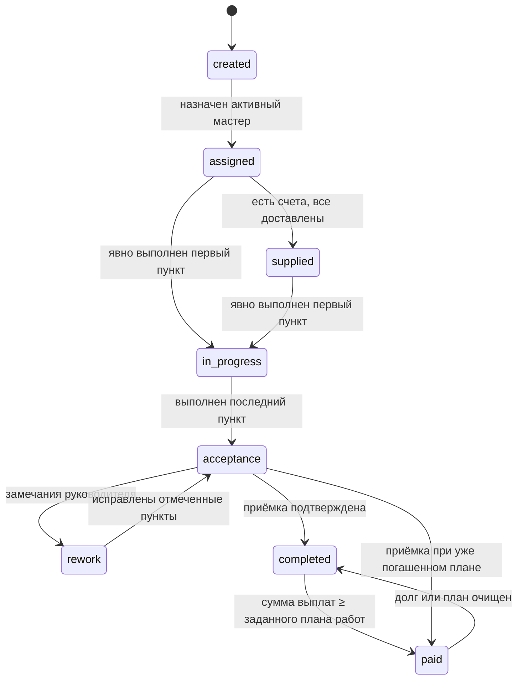

# API первой версии Stageby

Документ описывает целевое поведение API по редакции от 12.10.2026. Предметные правила определены в
[модели домена](domain-model.md) по [ТЗ edited.ver2](../plans/ТЗ%20на%20разработку%20страницы%20и%20сценарии%20edited.ver2.md), а исходники OpenAPI находятся в
[`contracts/references`](../contracts/references/). Сгенерированный `contracts/openapi.yaml`
вручную не редактируется. Интеграционные проверки выполняются на отдельной чистой БД.
Результаты проверки реализации описаны в [заметке о доработках бэкенда](edited-ver2-backend-update-release.md).
Заменённые правила перечислены в [решениях R1–R18](edited-ver2-decisions.md).
[Заметка о предыдущем выпуске](edited-ver2-release.md) описывает предыдущую поставку.

## Согласованный объём

- В системе работают руководитель (`manager`) и мастер участка (`foreman`).
- Объект создаётся атомарно с обязательными реквизитами, выбранными этапами и индивидуальными
  копиями шаблонов чек-листа.
- Выполнение пункта требует загруженную фотографию и отдельное явное действие «Готово».
- API учитывает планы и факты работ и материалов, частичные наличные выплаты, счета этапа,
  независимые оплату и доставку и отдельно устраняемые нехватки.
- Панель руководителя получает готовые серверные агрегаты и таблицу с индикаторами без задач.
- Файлы хранятся в закрытом S3-совместимом хранилище и доступны только после авторизации.
- Клиентские кабинеты, поставщики, инструмент, ЭДО и журнал действий не входят в первую версию.

## Общие правила контракта

| Область | Решение |
| --- | --- |
| Вход | Уникальный логин и пароль; необязательный телефон; непрозрачная сессия в защищённой HttpOnly cookie; email не используется |
| Идентификаторы | Положительные `integer/int32`, назначаемые БД |
| Даты | Календарные даты без времени; даты этапа независимо nullable и внутри обеих границ проекта, дата выплаты не ограничивается сроками проекта; timestamps в UTC, календарь Екатеринбурга UTC+5 |
| Деньги | Копейки, `integer/int64`, суффикс `AmountMinor`; записываемые суммы кратны 100 |
| Неизвестный план | `null`; значение не подменяется нулём |
| Конкурентность | `expectedVersion`; устаревшая версия возвращает `409 version_conflict` |
| Идемпотентность | Завершение загрузки и создание объекта защищаются серверным ключом; повтор после потери ответа возвращает прежний результат, другой запрос с тем же ключом — конфликт |
| Удаление | Пользователь деактивируется, проект архивируется; удаление выплаты сохраняется в аудите |
| Доступ мастера | Только назначенный этап и его вложенные ресурсы; чужой ID возвращает `404` |

API не принимает редактируемые значения для статуса проекта, прогресса, общих планов объекта,
агрегированных фактических сумм и остатков. Эти поля read-only, вычисляются сервером и не хранятся
в БД как отдельные поля. Общий план работ объекта = сумма ручных планов работ включённых этапов;
общий план материалов объекта = сумма ручных планов материалов включённых этапов.
Планы работ и материалов этапа — nullable-поля, сохраняемые в БД и редактируемые только руководителем вручную.

## Ресурсы

Целевой контракт группирует операции следующим образом:

- аутентификация, пользователи и запросы сброса пароля;
- проекты, составное создание и атомарное редактирование выбранных этапов;
- этапы, статусы, индивидуальные чек-листы, приёмка и чтение активных типов с шаблонами и `photoHint`;
- upload-сессии, файлы, документы проекта и фотографии пунктов;
- фактические выплаты этапа текущему назначенному мастеру;
- счета напрямую в этапе: `GET/POST /stages/{stageId}/material-invoices`, оплата, доставка и нехватки;
- независимые представления панели руководителя: `summary`, `projects`.

Списки используют `limit`, `offset`, документированную стабильную сортировку и `total`, посчитанный
только по доступным записям. Read-модели экрана не обязаны совпадать с полной карточкой ресурса.

## Основной сценарий

1. Руководитель входит по логину и создаёт учётные записи мастеров. Публичной регистрации нет.
2. При необходимости руководитель предварительно загружает PDF проекта через двухфазную
   upload-сессию и получает идентификаторы успешно загруженных файлов.
3. Руководитель одной атомарной операцией создаёт объект: передаёт клиента, адрес, координаты,
   сроки проекта, минимум один выбранный стандартный этап и необязательные PDF проекта.
   Даты каждого этапа независимо необязательны, мастер и планы nullable, чек-лист индивидуальный.
   Ручные планы работ и материалов сохраняются на этапе.
   Счета добавляются
   отдельной операцией уже существующего этапа; ошибка счёта не отменяет созданный объект.
4. Если состав пунктов не передан как изменённый, сервер копирует активный шаблон типа этапа.
   Добавление, переименование и удаление пунктов изменяет только новый объект. Ошибка любого этапа
   откатывает всю операцию.
5. Назначенный мастер видит этап в «Моих этапах», включая клиента, адрес, даты и суммы только этого
   этапа. Общая карточка объекта, другие этапы и их деньги ему недоступны.
6. Руководитель добавляет напрямую в этап до 10 счетов с положительными суммами. Только руководитель
   отмечает оплату, изменяет сумму, поставщика и файл через `PATCH /material-invoices/{invoiceId}`,
   удаляет счёт вместе с нехватками через `DELETE /material-invoices/{invoiceId}` с `expectedVersion`
   в теле (ответ `204`). Изменение реквизитов сохраняет оплату и доставку; удаление пересчитывает
   финансовые итоги и материалы. Руководитель или назначенный мастер отмечает доставку каждого счёта и может
   сообщить о нехватке.
7. Этап становится `supplied`, только когда существует хотя бы один счёт и все счета этапа
   доставлены. Начать работу можно из `assigned`; невыполненный непосредственно предыдущий
   включённый этап вызывает предупреждение, но не блокирует старт.
8. Мастер загружает минимум одну фотографию пункта. Завершение upload-сессии сохраняет фото, но не
   меняет пункт. После успешной загрузки мастер отдельно нажимает «Готово»; сервер фиксирует автора
   и время выполнения.
9. Явное выполнение первого пункта впервые переводит этап из `assigned` или `supplied` в
   `in_progress` и устанавливает `actualStartDate`. Выполнение последнего пункта непустого чек-листа
   переводит этап в `acceptance`.
10. Руководитель принимает этап либо возвращает его в `rework`, указав хотя бы один пункт
    с индивидуальным обязательным комментарием и общий срок исправления. Мастер повторно работает
    только с отмеченными пунктами; после их выполнения
    этап снова переходит в `acceptance`. Файл акта не требуется.
11. Приёмка переводит этап в `completed` или сразу в `paid`, если заданный план работ уже погашен.
    Платежи за работы можно добавлять частями; факт равен их сумме. Статус оплаты автоматически
    пересчитывается при изменении выплат и ручного плана в обе стороны.
    Каждая выплата хранит получателя, который не меняется при переназначении мастера.
12. Объект получает `completed`, когда все включённые этапы достигли `paid`; отдельного статуса
    «Передан клиенту» нет. Остальные статусы вычисляются по правилам предметной модели.

Пример целевого составного запроса создания:

```json
{
  "ownerName": "Иван Иванов",
  "address": "Екатеринбург, ул. Примерная, 12",
  "coordinates": {
    "latitude": 56.838011,
    "longitude": 60.597474
  },
  "plannedStartDate": "2026-10-05",
  "plannedEndDate": "2027-05-28",
  "documentFileIds": [41],
  "stages": [
    {
      "type": "foundation",
      "plannedStartDate": "2026-10-05",
      "plannedEndDate": "2026-10-30",
      "assigneeId": 17,
      "plannedWorkAmountMinor": 50000000,
      "plannedMaterialAmountMinor": 70000000,
      "checklistItems": [
        {
          "title": "Армирование",
          "photoHint": "Фото перевязки углов и перехлёста арматуры"
        }
      ]
    }
  ]
}
```

Суммы `50000000` и `70000000` означают 500 000 и 700 000 рублей соответственно.

Создание поддерживает сохранение с шага «Объект» или любого экрана этапа (§3.4 ТЗ).
Имя клиента обязательно и ограничено 150 символами; адрес, координаты и обе даты проекта обязательны.
Клиент передаёт все включённые стандартные этапы, в том числе неоткрытые: для них достаточно типа,
активный шаблон копируется сервером, даты, мастер и планы остаются `null`.
Отсутствующие в списке типы не создаются. Пустой список этапов, дубли типов, `additional` и
переданный пустой чек-лист отклоняются. Необязательный список PDF может быть пустым;
файлы проверяются до создания. Объект, этапы, чек-листы, связи файлов и аудит
сохраняются в одной транзакции. Ошибки содержат пути полей и индексы этапов для открытия
экрана с первой ошибкой. Ответ возвращает актуальный объект с вычисленными финансовыми итогами.
После успеха UI переходит на дашборд; сохранение данных между экранами относится к UI (R10).

## Редактирование объекта

`GET /projects/{projectId}/edit` доступен руководителю и возвращает согласованный снимок
`{ project, stages }`. В `stages` входят включённые и исключённые записи по позиции;
каждая содержит `stage` и `checklist` с ID и версиями. Обычные списки
этапов показывают только включённые записи, максимум девять с дополнительным этапом.

`PATCH /projects/{projectId}` требует `expectedVersion` объекта. В `stages` передаются
частичные изменения существующих этапов с `id` и `expectedVersion`; отсутствие этапа
сохраняет его. `isIncluded` явно исключает или восстанавливает запись. Обе даты независимо
nullable. Состав чек-листа передаётся в `checklist: { expectedVersion, items }` только до
фактического старта; повтор неизменного состава сохраняет ID пунктов. Изменённый состав
сохраняет старые пункты и фото в истории. Ручные планы этапов не изменяются выплатами.

`documentFileIds` заменяет список PDF целиком, сохраняет ID оставшихся связей и порядок.
Новые файлы должны быть загруженными PDF руководителя; файл другого объекта недоступен.
Ошибки связанных данных имеют пути полей, конфликт любой версии возвращает
`409 version_conflict`. Итоговые даты, включённость и назначения
проверяются до записи; ошибка отменяет всю форму и аудит. Все изменения записываются
одним событием `updateProject`, версия объекта увеличивается один раз. Неизменные значения
с актуальными версиями не создают событий и не увеличивают версии.

Архивный объект допускает только отдельное разархивирование с `isArchived: false` и
актуальной версией. Остальные изменения возвращают `409 project_archived`.
Изменения этапов, выплат, счетов и фото блокируют сначала объект, затем этап и
вложенные ресурсы. Проверки дат в PostgreSQL отложены до конца транзакции и оценивают
итоговое состояние совместного изменения сроков.

## Статусы



Пропуск остальных переходов запрещён. Доставка после фактического старта не откатывает этап в
`supplied`. Статус проекта имеет только значения `created`, `in_progress`, `acceptance`, `completed`
и всегда вычисляется по правилам предметной модели.

## Чек-лист и фотографии

Операция загрузки фотографии и операция выполнения пункта разделены:

1. создать upload-сессию с назначением «фото пункта»;
2. загрузить JPEG, PNG или HEIC размером до 20 МБ;
3. подтвердить загрузку и получить файл со статусом `uploaded`;
4. связать фотографию с пунктом;
5. отдельным запросом установить `isCompleted: true` с актуальной версией.

Шаг 5 отклоняется, если у пункта нет загруженной фотографии. Повторное завершение загрузки с тем же
ключом идемпотентности не создаёт дубликат. Удаление последнего фото выполненного пункта требует
подтверждения и снимает отметку. На один пункт можно привязать не более 20 активных фотографий;
попытка добавить двадцать первую возвращает `409 photo_limit_exceeded`. Лимит проверяется атомарно,
включая конкурентные запросы. Удалённая фотография освобождает место. Фото получает срок хранения
один год от успешной загрузки.
Выход после загрузки без «Готово» сохраняет фото без выполнения. Фоновое удаление через год
не снимает выполнение, прогресс и статус; новое выполнение и доработка требуют нового фото.

В ответе пункта `photoCount` показывает число доступных фото (0 — фото отсутствуют),
`photosDeletedByRetention` — наличие фото, удалённых по сроку хранения, `reworkComment` — последнее
замечание к пункту или `null`. При доработке выполнение требует фото, загруженного после последнего
возврата этого пункта. Повтор привязки активного файла к тому же пункту возвращает прежнюю запись
без дубля и нового аудита. Мастер не может привязывать или удалять фото на приёмке; в доработке
меняет только возвращённые пункты. После `completed`/`paid` операции с фото запрещены всем ролям.
Удаление последнего доступного фото выполненного пункта требует query-параметр
`confirmLastPhotoDeletion=true`, иначе `409 photo_deletion_confirmation_required`. Подтверждение
снимает выполнение и увеличивает версии чек-листа и этапа в одной транзакции. Руководитель может
удалить фото на приёмке; снятие выполнения возвращает этап в `in_progress`.

`POST /stages/{stageId}/rework` принимает `expectedVersion`, общий `correctionDueDate` и непустой
массив `items: [{ itemId, comment }]`. Каждый пункт имеет обязательный комментарий от 1 до 5000
символов после удаления пробелов по краям; повторение ID запрещено. Старые поля `comment` и
`itemIds` не принимаются. При возврате `latestAcceptance.comment = null`, индивидуальные
замечания возвращаются через `ChecklistItem.reworkComment`. Перенос старых записей не предусмотрен.

## Работы и материалы

План работ `plannedWorkAmountMinor` и план материалов `plannedMaterialAmountMinor` — nullable-поля
этапа, сохраняемые в БД. Их задаёт и изменяет вручную только руководитель. `null` означает
незаданный план, 0 — заданный нулевой. Общие планы объекта вычисляются из ручных планов
включённых этапов, не редактируются и не хранятся в БД. Выплаты принадлежат этапу напрямую.
Факт работ вычисляется из выплат, факт материалов — из фактических сумм оплаты оплаченных счетов.
Неоплаченный счёт не влияет на факт, доставка не означает оплату. Суммы счетов не меняют ручной план.

Выплата принадлежит этапу напрямую. При создании сервер фиксирует текущего назначенного
активного мастера как получателя. Без такого назначения добавление запрещено.
Получателя нельзя редактировать; переназначение этапа влияет только на новые выплаты.
Руководитель может исправить сумму, дату и комментарий или удалить выплату.
Все выплаты этапа, включая выплаты прежним мастерам, входят в факт и расчёт статуса.
Руководитель видит все выплаты; назначенный мастер — только свои выплаты и агрегаты своего этапа.
Дата выплаты не ограничивается плановыми датами проекта; календарь — Екатеринбург.
Отрицательный остаток означает переплату.

После приёмки статус рассчитывается автоматически: `paid`, если ручной план работ задан
и сумма всех выплат этапа не меньше плана; иначе `completed`. Нулевой план даёт `paid`
без выплат, `null` оставляет `completed`. Полная предоплата не завершает непринятый этап.
При изменении плана, создании, исправлении или удалении выплаты статус пересчитывается
в той же транзакции под блокировкой этапа. При появлении долга или очищении плана
`paid` возвращается в `completed`; приёмка и фактические даты сохраняются.
Ручного перехода в `paid` нет. Оплата материалов не влияет на этот статус.

Оплата счёта требует положительную фактическую сумму и календарную дату, которые хранятся
отдельно от суммы выставления. Серверные время и автор отметки — служебные поля, время отметки
не подменяет введённую дату. При снятии оплаты фактическая сумма и дата очищаются;
сумма выставления и ручной план сохраняются, факт и остаток пересчитываются.

Счёт принадлежит этапу напрямую через `stageId`. Нехватка принадлежит
конкретному счёту. Руководитель или назначенный мастер открывает её с
обязательным комментарием до 500 символов. Появление следующего счёта не закрывает нехватку:
отдельную операцию устранения выполняет руководитель.

Новый счёт принимает PDF/JPEG до 10 МиБ (10 × 1024² байт); PDF проекта остаётся до 50 МиБ,
фото — до 20 МиБ. Размер проверяется при создании и завершении upload-сессии и при привязке.
Лимит 10 счетов проверяется в транзакции
под блокировкой этапа; конкурентная попытка создать 11-й возвращает `409 invoice_limit_exceeded`.
Идентификаторы операций изменения счёта и нехватки сохраняются.

Повтор создания счёта с тем же `fileId`, этапом, суммой и поставщиком возвращает прежний
счёт с HTTP 201, включая повтор при заполненном лимите 10 счетов. Изменённые данные или другой
этап для уже привязанного файла возвращают `400 invalid_request`. Повтор не создаёт событие аудита.
`Stage.materialSummary` использует общий `MaterialIndicator`: цвет, количества счетов и нехваток,
а также независимые признаки `isPartiallyPaid` и `isPartiallyDelivered`.

Общая выборка `loadStageSummaries` принимает несколько этапов и отдельно агрегирует платежи,
оплаченные счета и нехватки. Она используется при чтении этапов, объектов и панели руководителя.
Неизвестный план и остаток сохраняются как `null`.

### Операции объектов и этапов

`GET /projects` и `GET /projects/{projectId}` доступны только руководителю. Объект возвращает
вычисляемые `status`, `finances` и `documentFileIds`. Финансовый итог объединяет все включённые этапы,
сохраняя `null` для неполного плана и остатка каждой категории, факт остаётся доступен.
Для заполнения двух шагов редактирования руководитель получает реквизиты, PDF, параметры этапов,
чек-листы с ID и версии проекта и вложенных ресурсов, включая исключённые этапы
для восстановления. Обычные списки этапов показывают только включённые.

`PATCH /projects/{projectId}` расширяется одним атомарным сохранением реквизитов, документов,
дат, параметров этапов, индивидуальных чек-листов, включённости и дополнительного
этапа (§3.5 ТЗ). Версии проекта и изменяемых вложенных ресурсов проверяются до сохранения;
конфликт возвращает `409 version_conflict`, ошибка любой части откатывает всю форму и аудит.
Изменения включённости увеличивают версию проекта. Отсутствующее поле сохраняет значение,
`null` очищает nullable-поле; пропуск этапа не исключает его, включённость передаётся явно.
Проверяется итоговое состояние, включая совместное изменение сроков проекта и этапов.
SQL-проверки не должны отклонять его из-за промежуточного состояния. Соседние этапы не переносятся.
Архивные объекты сохраняют запрет изменений.

Планы работ и материалов этапа руководитель редактирует вручную; общий план объекта остаётся
read-only и вычисляется из планов включённых этапов. Выплаты редактируются с их ID и версиями.
Исключение этапа разрешено только при `actualStartDate = null` и без связанных фото, счетов
и выплат. Удалённые фото также блокируют исключение.
Минимум один включённый этап обязателен. Восстановление использует тот же ID, планы и чек-лист
с проверкой актуальных дат, назначения и непустого списка пунктов.

`additional` добавляется только при редактировании, имеет фиксированное название, последнюю
позицию и непустой индивидуальный чек-лист без шаблона. Тип уникален внутри объекта, включая
исключённые записи: ранее исключённый дополнительный этап восстанавливается.
Его добавление к завершённому объекту возвращает объект в активные; этап участвует в завершении.

`GET /stages` возвращает страницу этапов, `GET /projects/{projectId}/stages` — все доступные этапы
объекта без пагинации. Ограничение по назначенному мастеру применяется до фильтров и подсчёта
`total`; `completed` и `paid` остаются в списке. Архивы исключены из `/stages` по умолчанию.
`Stage` в карточке, списках, ответах мутаций и снимке редактирования содержит актуальный контекст
проекта: `projectDocumentFileIds` (только прикреплённые загруженные PDF в порядке документов),
`projectPlannedStartDate`, `projectPlannedEndDate`, а также nullable-телефон `assignee.phone`.
Назначенный мастер получает эти данные без доступа к `getProject`; PDF открывается через
`getFileContent`. Пустой массив документов означает отсутствие загруженного проекта.
`includedStageNumber` — номер с 1 среди всех включённых этапов объекта по позиции, затем ID,
независимо от назначения мастерам; `includedStageCount` — их количество, включая дополнительный.
Для исключённого этапа в ответе руководителя номер равен `null`. Поле `position` сохраняет
фиксированную позицию типа. Изменения контекста проекта и телефона не меняют версию этапа;
проверка дат при сохранении использует текущие границы проекта.
`GET /stage-types` возвращает руководителю восемь стандартных типов с активными непустыми
шаблонами и девятый тип `additional` без шаблона; при создании объекта он недоступен.

`PATCH /stages/{stageId}` принимает любое непустое сочетание `assigneeId`, `plannedStartDate`,
`plannedEndDate`, `plannedWorkAmountMinor`, `plannedMaterialAmountMinor`, `workSubtypes` и `notes`,
а также обязательную `expectedVersion`. Проверки выполняются по результирующей записи; версия
увеличивается один раз. Повтор текущих значений с актуальной версией ничего не меняет.
Изменение зависимостей в этот запрос не входит: последовательность определяется позициями
включённых этапов. Мастер не может выполнять этот PATCH. Плановые даты, назначенный мастер и
планы могут изменяться после старта, включая `completed` и `paid`, без переписывания фактических
дат и прошлых выплат. Оба плана этапа — ручные nullable-поля руководителя.
Обе даты независимо nullable: каждая заданная находится между обеими границами проекта,
порядок проверяется только при наличии обеих. Для назначения нужен активный `foreman`.
Правки и очищение плана, изменение или удаление выплат пересчитывают статус `completed`/`paid`.
Появление долга или незаданный план возвращают `paid` в `completed`, сохраняя приёмку и фактические даты.

`PUT /stages/{stageId}/checklist` заменяет состав только при `actualStartDate = null`.
Создаёт новые пункты без отметок; старые сохраняются с `deletedAt` вместе с фотографиями и историей,
исключаются из текущего прогресса и операций. Изменение и версии чек-листа и этапа записываются
в одной транзакции аудита. После старта замена запрещена, поэтому история приёмки не удаляется.
Последующее снятие выполнения не открывает правку состава или исключение этапа.

`POST /projects` требует `Idempotency-Key` (16–100 допустимых символов). Ключ привязан к автору;
сервер хранит его хеш и хеш нормализованного тела в служебных полях проекта. Повтор с тем же
телом возвращает существующий объект с HTTP 201, без новых записей и события аудита. Изменённое
тело с тем же ключом возвращает `409 idempotency_conflict`; другой ключ создаёт другой объект.
PDF для создания должен быть загружен автором запроса. Назначенный мастер получает доступ
к PDF проекта через свой этап; после переназначения прежний мастер теряет доступ к этапу,
счетам, фото и PDF (если у него больше нет назначенных этапов этого проекта).
Назначенный мастер также читает собственные выплаты по правилам финансового доступа.

Индикатор материалов красный при отсутствии счетов или открытой нехватке, жёлтый при неполной
оплате/доставке, зелёный при полной оплате и доставке без нехваток. Подписи частичной оплаты
и доставки вычисляются независимо по числу счетов. Добавление счёта не меняет план и не
увеличивает факт до отметки оплаты с фактической суммой и датой.

## Панель руководителя

Данные экрана разделяются на два независимых запроса, чтобы ошибка одного блока не блокировала
остальные:

- `GET /dashboard/summary?through=YYYY-MM-DD` — агрегаты планов и фактов;
- `GET /dashboard/projects?limit=...&offset=...` — компактные строки объектов.

`through` по умолчанию сегодня, допустим сегодня…сегодня + 30 дней включительно в Екатеринбурге
UTC+5. Вчера и +31 день отклоняются сервером. Расчёт использует включённые этапы объектов вне
архива, включая выплаченные. Работы и материалы включаются по окончанию этапа ≤ `through`; без окончания этап
не учитывается. Планы берутся из ручных планов этапов. Факт включает выплаты и фактические
суммы оплаты счетов тех же этапов с датой оплаты ≤ `through`.
Оплата не уменьшает план; остаток = план − факт с сохранением переплаты.
Незаданный план выбранного этапа делает план категории и её остаток неизвестными (`null`),
факт остаётся доступен. Неизвестная категория делает общий план и остаток неизвестными.
Нулевой план считается заданным; при пустом наборе этапов суммы равны 0.
Этапы вне выбранной даты не влияют на полноту. Расчёт накопительный и включает просроченные этапы.
Общий план объекта по-прежнему вычисляется из ручных планов всех включённых этапов.

Строка объекта содержит один `stageId`: первый включённый по позиции невыплаченный этап.
Все даты, суммы, мастер и индикаторы строки относятся к этому этапу. Выплата последнего этапа
раньше предыдущих не завершает объект. Tasks API и данные отправки заявок не входят в объём.
`selectedStage.position` — порядковый номер среди включённых этапов объекта для подписи «N из K».

Оба запроса обслуживает `api/src/modules/dashboard`. Таблица исключает архивные объекты,
сортируется по началу выбранного этапа, затем ID объекта; строки без начала и полностью
выплаченные идут в конце. Без начала не применяется предупреждение о неназначенном мастере за 7 дней.
Исключённые этапы не участвуют в финансах, выборе этапа и активном счётчике.
`selectedStage.finances` содержит суммы выбранного этапа, `finances` строки — суммы всех этапов
объекта по всем включённым этапам. Данные загружаются пакетами без отдельного запроса на каждый объект.

## Запрос сброса пароля и получатели выплат

`POST /auth/password-reset-requests` публично принимает `{ login }` и возвращает одинаковый
HTTP 202 без тела для активного, неизвестного и неактивного пользователя. Ограничения по IP
и логину используют настройки лимита входа, с отдельными счётчиками. Активному пользователю
устанавливается `passwordResetRequestedAt`, доступное руководителю в списке и карточке.
Повтор открытого запроса не создаёт нового аудита. Назначение пароля через
`PUT /users/{userId}/password` закрывает запрос и отзывает сессии в одной транзакции.
Публичный запрос записывается без автора; пароль и хеш не попадают в снимки аудита.

`POST /stages/{stageId}/work-payments` принимает `paidAt`, `amountMinor` и необязательный
`comment`. Получателя сервер копирует из текущего активного назначения этапа.
`PATCH /work-payments/{paymentId}` принимает `expectedVersion` и изменения суммы, даты или
комментария; получатель неизменяем. `DELETE` требует `expectedVersion` в теле.
Переназначение этапа не изменяет получателей прошлых выплат. Назначенный мастер читает только
выплаты себе, руководитель — все выплаты этапа. Без назначения доступ мастера прекращается.
Строк плана выплат и операций их распределения нет.

## Доступ и ошибки

Руководитель имеет доступ ко всем операциям. Мастер может читать свой этап и его суммы, загружать
фотографии, выполнять доступные пункты, отмечать доставку и открывать нехватку. Он не меняет планы,
платежи, оплату счёта, состав чек-листа, приёмку или устранение нехватки.

Ошибки имеют единый объект с `error`, `code`, `message` и при необходимости `details`:

- `400` — формат, валидация связанных полей или недопустимый переход;
- `401` — отсутствующая или истёкшая сессия, включая отозванную сессию отключённого аккаунта; фронтенд не различает эти причины;
- `403` — операция запрещена роли;
- `404` — ресурс отсутствует или недоступен мастеру;
- `409` — конфликт версии, состояния или ключа идемпотентности;
- `413` — превышен размер файла;
- `429` — превышено ограничение попыток входа.

На фронтенде запрещённые и несуществующие страницы показывают одинаковую заглушку 404,
включая ответы `403` при загрузке страницы. Это правило отображения не меняет статусы API.
При входе отключённый аккаунт и неверные реквизиты получают одинаковое сообщение без раскрытия
состояния аккаунта. Руководитель (`manager`, администратор) может просматривать страницы обеих ролей.

Файловые ошибки различают неподдерживаемый MIME, превышение размера, checksum mismatch,
незавершённую и истёкшую upload-сессию. Запрещённые и неизвестные поля отклоняются, а не молча
игнорируются.

## Проверки при реализации

Контракт и интеграционные тесты должны доказать как минимум:

- атомарное создание объекта без частично сохранённых этапов;
- запрет объекта без адреса, координат, сроков, этапов или пунктов;
- независимость индивидуального чек-листа от шаблона;
- создание с любого шага, неоткрытые этапы с шаблонами без дат и планов, идемпотентность создания;
- четыре сочетания nullable-дат, независимое очищение, обе границы проекта и общее изменение сроков;
- атомарное редактирование всей формы, версии вложенных ресурсов и аудит побочных изменений;
- исключение, восстановление того же ID, запрет исключения последнего этапа и этапа с удалёнными фото;
- единственный `additional` без шаблона, его восстановление и возврат завершённого объекта в активные;
- выплаты текущему активному мастеру, неизменяемость получателя и отказ без назначения;
- смену и очищение получателя с сохранением истории и доступом только к собственной детализации;
- автоматические переходы `completed ↔ paid` при изменениях планов и выплат, правки завершённых этапов;
- отсутствие выполнения пункта после одной лишь загрузки фото;
- запрет выполнения без загруженного фото;
- успешную привязку 20 фотографий и отказ для двадцать первой, включая конкурентные запросы;
- корректные переходы первого и последнего пунктов;
- доработку только отмеченных пунктов;
- частичные платежи, переплату, отдельную сумму и дату оплаты счёта и их очищение при снятии оплаты;
- отбор этапов по окончанию, аванс, оплату до/в/после D, нулевой и незаданный план, пустой периметр;
- 0/1/10 счетов этапа, отказ для 11-го и конкурентные запросы при 9 счетах;
- отдельное закрытие нехватки;
- отсутствие у мастера доступа к чужим этапам и общим финансовым агрегатам;
- одинаковые расчёты в карточке этапа, проекте и панели руководителя.

Все мутации записывают событие аудита с побочными изменениями в той же транзакции.
Публичная read-модель не раскрывает мастеру объект, чужие этапы или общие финансовые суммы;
переназначение отзывает доступ к вложенным ресурсам и прямым ссылкам.
Отдельные операции и составное сохранение используют согласованный порядок блокировок.
Поставка рассчитана на БД без прикладных данных. Перенос старых объектов и выплат не входит
в объём; существующие данные автоматически не удаляются. Исходные контракты, миграции,
серверная реализация и codegen обновляются следующими шагами плана.
