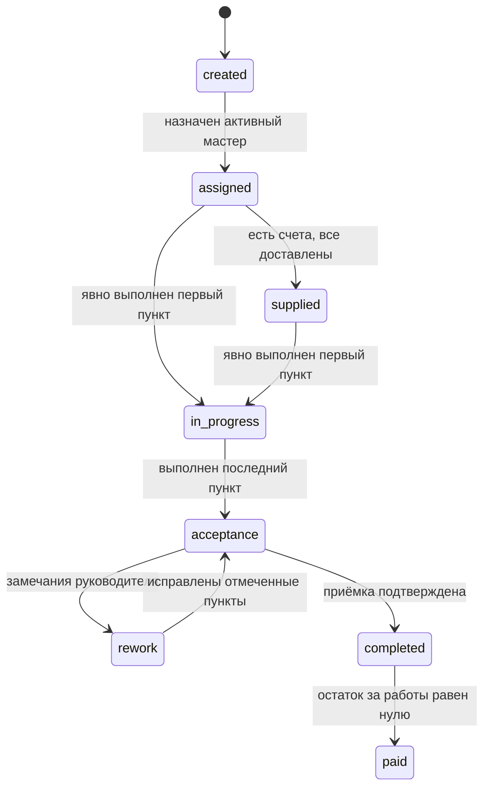

# API первой версии Stageby

Документ описывает целевое поведение API. Предметные правила определены в
[модели домена](domain-model.md), а исходники OpenAPI находятся в
[`contracts/references`](../contracts/references/). Контракт и реализация приводятся к этой модели
в следующих фазах; сгенерированный `contracts/openapi.yaml` вручную не редактируется.

## Согласованный объём

- В системе работают руководитель (`manager`) и мастер участка (`foreman`).
- Объект создаётся атомарно с обязательными реквизитами, выбранными этапами и индивидуальными
  копиями шаблонов чек-листа.
- Выполнение пункта требует загруженную фотографию и отдельное явное действие «Готово».
- API учитывает планы и факты работ и материалов, частичные платежи, несколько заказов на этап,
  несколько счетов на заказ, доставку и нехватки.
- Панель руководителя получает готовые серверные агрегаты и вычисляемые задачи.
- Файлы хранятся в закрытом S3-совместимом хранилище и доступны только после авторизации.
- Клиентские кабинеты, поставщики, инструмент, ЭДО и журнал действий не входят в первую версию.

## Общие правила контракта

| Область | Решение |
| --- | --- |
| Вход | Уникальный логин и пароль; непрозрачная сессия в защищённой HttpOnly cookie; email не используется |
| Идентификаторы | Положительные `integer/int32`, назначаемые БД |
| Даты | Календарные даты без времени; timestamps передаются в UTC |
| Деньги | Копейки, `integer/int64`, суффикс `AmountMinor`; записываемые суммы кратны 100 |
| Неизвестный план | `null`; значение не подменяется нулём |
| Конкурентность | `expectedVersion`; устаревшая версия возвращает `409 version_conflict` |
| Идемпотентность | Завершение загрузки защищается ключом идемпотентности; повторную отправку формы создания объекта предотвращает frontend |
| Удаление | Пользователь деактивируется, проект архивируется, финансовая история физически не удаляется |
| Доступ мастера | Только назначенный этап и его вложенные ресурсы; чужой ID возвращает `404` |

API не принимает редактируемые значения для статуса проекта, прогресса, фактических сумм и
остатков. Эти поля read-only и вычисляются сервером.

## Ресурсы

Целевой контракт группирует операции следующим образом:

- аутентификация, пользователи и запросы сброса пароля;
- проекты и составное создание выбранных этапов;
- этапы, статусы, индивидуальные чек-листы и приёмка;
- upload-сессии, файлы, документы проекта и фотографии пунктов;
- платежи за работы;
- заказы материалов этапа, вложенные счета, оплата, доставка и нехватки;
- независимые представления панели руководителя: `summary`, `tasks`, `projects`.

Списки используют `limit`, `offset`, документированную стабильную сортировку и `total`, посчитанный
только по доступным записям. Read-модели экрана не обязаны совпадать с полной карточкой ресурса.

## Основной сценарий

1. Руководитель входит по логину и создаёт учётные записи мастеров. Публичной регистрации нет.
2. При необходимости руководитель предварительно загружает PDF проекта через двухфазную
   upload-сессию и получает идентификаторы успешно загруженных файлов.
3. Руководитель одной атомарной операцией создаёт объект: передаёт клиента, адрес, координаты,
   сроки проекта, минимум один выбранный этап и PDF проекта. Для каждого этапа задаёт даты,
   параллельность, необязательного мастера, nullable-планы работ и материалов и пункты чек-листа.
4. Если состав пунктов не передан как изменённый, сервер копирует активный шаблон типа этапа.
   Добавление, переименование и удаление пунктов изменяет только новый объект. Ошибка любого этапа
   откатывает всю операцию.
5. Назначенный мастер видит этап в «Моих этапах», включая клиента, адрес, даты и суммы только этого
   этапа. Общая карточка объекта, другие этапы и их деньги ему недоступны.
6. Руководитель создаёт для этапа один или несколько заказов и отмечает отправку каждого. Внутри
   заказа он загружает один или несколько счетов с положительными суммами. Только руководитель
   отмечает оплату. Руководитель или назначенный мастер отмечает доставку каждого счёта и может
   сообщить о нехватке.
7. Этап становится `supplied`, только когда существует хотя бы один заказ, у каждого заказа есть
   хотя бы один счёт и доставлены все счета всех заказов этапа. Начать работу всё же можно из
   `assigned`.
8. Мастер загружает минимум одну фотографию пункта. Завершение upload-сессии сохраняет фото, но не
   меняет пункт. После успешной загрузки мастер отдельно нажимает «Готово»; сервер фиксирует автора
   и время выполнения.
9. Явное выполнение первого пункта впервые переводит этап из `assigned` или `supplied` в
   `in_progress` и устанавливает `actualStartDate`. Выполнение последнего пункта непустого чек-листа
   переводит этап в `acceptance`.
10. Руководитель принимает этап либо возвращает его в `rework`, указав комментарий, новый срок и
    хотя бы один пункт. Мастер повторно работает только с отмеченными пунктами; после их выполнения
    этап снова переходит в `acceptance`.
11. После приёмки руководитель переводит этап в `completed`. Платежи за работы можно добавлять
    частями; факт равен их сумме. Переход `completed → paid` разрешён только при нулевом остатке.
12. Статус объекта вычисляется по фактическому старту и последнему включённому этапу. Когда последний
    этап достиг `paid`, объект получает `completed`; отдельного статуса «Передан клиенту» нет.

Пример целевого составного запроса создания:

```json
{
  "ownerName": "Иван Иванов",
  "address": "Екатеринбург, ул. Примерная, 12",
  "coordinates": {
    "latitude": 56.838011,
    "longitude": 60.597474
  },
  "plannedStartDate": "2026-10-05",
  "plannedEndDate": "2027-05-28",
  "documentFileIds": [41],
  "stages": [
    {
      "type": "foundation",
      "plannedStartDate": "2026-10-05",
      "plannedEndDate": "2026-10-30",
      "canRunInParallel": false,
      "assigneeId": 17,
      "plannedWorkAmountMinor": 50000000,
      "plannedMaterialAmountMinor": 70000000,
      "checklistItems": [
        {
          "title": "Армирование",
          "photoHint": "Фото перевязки углов и перехлёста арматуры"
        }
      ]
    }
  ]
}
```

Суммы `50000000` и `70000000` означают 500 000 и 700 000 рублей соответственно.

## Статусы



Пропуск остальных переходов запрещён. Доставка после фактического старта не откатывает этап в
`supplied`. Статус проекта имеет только значения `created`, `in_progress`, `acceptance`, `completed`
и всегда вычисляется по правилам предметной модели.

## Чек-лист и фотографии

Операция загрузки фотографии и операция выполнения пункта разделены:

1. создать upload-сессию с назначением «фото пункта»;
2. загрузить JPEG, PNG или HEIC размером до 20 МБ;
3. подтвердить загрузку и получить файл со статусом `uploaded`;
4. связать фотографию с пунктом;
5. отдельным запросом установить `isCompleted: true` с актуальной версией.

Шаг 5 отклоняется, если у пункта нет загруженной фотографии. Повторное завершение загрузки с тем же
ключом идемпотентности не создаёт дубликат. Удаление последнего фото выполненного пункта требует
подтверждения и снимает отметку. На один пункт можно привязать не более 20 активных фотографий;
попытка добавить двадцать первую возвращает `409 photo_limit_exceeded`. Лимит проверяется атомарно,
включая конкурентные запросы. Удалённая фотография освобождает место. Фото получает срок хранения
один год от успешной загрузки.

## Работы и материалы

План работ и план материалов — nullable-поля этапа, доступные для изменения только руководителю.
Факт работ вычисляется из платежей, факт материалов — только из оплаченных счетов. Неоплаченный счёт
не влияет на факт, а доставка не означает оплату.

Счёт принадлежит конкретному заказу, а этап определяется через этот заказ. Нехватка принадлежит
конкретному счёту. Руководитель или назначенный мастер открывает её с
обязательным комментарием до 500 символов. Появление следующего счёта не закрывает нехватку:
отдельную операцию устранения выполняет руководитель.

## Панель руководителя

Данные экрана разделяются на три независимых запроса, чтобы ошибка одного блока не блокировала
остальные:

- `GET /dashboard/summary?through=YYYY-MM-DD` — агрегаты планов и фактов;
- `GET /dashboard/tasks` — вычисляемые задачи;
- `GET /dashboard/projects?limit=...&offset=...` — компактные строки объектов.

План к дате включает этапы с `plannedEndDate <= through`. Работы, материалы и общий итог возвращаются
раздельно. Отклонение равно `(план − факт) / план × 100`; при нулевом, отсутствующем или неполном
плане возвращается `null`.

Задачи вычисляются при чтении и исчезают вместе с условием, которое их породило:

- отправить заказ за семь дней до старта, если заказ не отправлен;
- запросить счёт для каждого заказа через два дня после его отправки, если у заказа нет счетов;
- проверить каждую открытую нехватку;
- назначить мастера за семь дней до старта, если он не назначен.

## Доступ и ошибки

Руководитель имеет доступ ко всем операциям. Мастер может читать свой этап и его суммы, загружать
фотографии, выполнять доступные пункты, отмечать доставку и открывать нехватку. Он не меняет планы,
платежи, оплату счёта, состав чек-листа, приёмку или устранение нехватки.

Ошибки имеют единый объект с `error`, `code`, `message` и при необходимости `details`:

- `400` — формат, валидация связанных полей или недопустимый переход;
- `401` — отсутствующая или истёкшая сессия;
- `403` — операция запрещена роли;
- `404` — ресурс отсутствует или недоступен мастеру;
- `409` — конфликт версии, состояния или ключа идемпотентности;
- `413` — превышен размер файла;
- `429` — превышено ограничение попыток входа.

Файловые ошибки различают неподдерживаемый MIME, превышение размера, checksum mismatch,
незавершённую и истёкшую upload-сессию. Запрещённые и неизвестные поля отклоняются, а не молча
игнорируются.

## Проверки при реализации

Контракт и интеграционные тесты должны доказать как минимум:

- атомарное создание объекта без частично сохранённых этапов;
- запрет объекта без адреса, координат, сроков, этапов или пунктов;
- независимость индивидуального чек-листа от шаблона;
- отсутствие выполнения пункта после одной лишь загрузки фото;
- запрет выполнения без загруженного фото;
- успешную привязку 20 фотографий и отказ для двадцать первой, включая конкурентные запросы;
- корректные переходы первого и последнего пунктов;
- доработку только отмеченных пунктов;
- частичные платежи, переплату и факт материалов только из оплаченных счетов;
- несколько заказов этапа и несколько независимо учитываемых счетов каждого заказа;
- отдельное закрытие нехватки;
- отсутствие у мастера доступа к чужим этапам и общим финансовым агрегатам;
- одинаковые расчёты в карточке этапа, проекте и панели руководителя.
